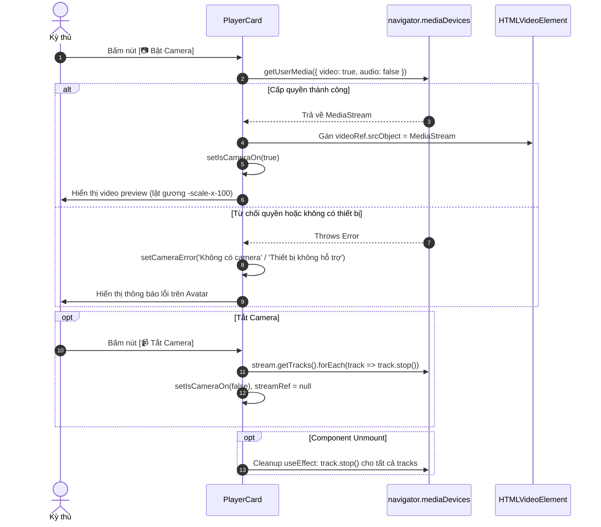

# @xiangqi-arena/web

Ứng dụng web Next.js 14 (App Router) cho Xiangqi Arena — Phòng thi đấu Cờ Tướng trực tuyến 3 cột hoàn chỉnh với bàn cờ SVG tương tác Click-to-Move, đồng hồ đếm ngược lượt đi 60s, webcam preview cục bộ, khung chat thời gian thực và hệ thống modal thông báo.

## Auth mock (XQA-213)

- Mở `/login` hoặc `/register`; trang Home có nút dẫn tới đăng nhập.
- Đăng nhập thử bằng `player1` / `arena1234`. Mock trả `401 AUTH_INVALID_CREDENTIALS` khi thông tin không khớp và `409 AUTH_IDENTIFIER_TAKEN` khi đăng ký trùng username/email.
- Form kiểm tra dữ liệu ở client theo [Auth REST contract](../../docs/api/auth.md), gồm password 8–72 ký tự và giới hạn 72 byte UTF-8.
- Lời gọi đăng nhập/đăng ký nằm trong `lib/auth-api.ts`. Thay mock bằng HTTP client thật tại file này khi làm XQA-214; các form không gọi backend trực tiếp.
- Đây là mock trong bộ nhớ để phát triển UI: tài khoản đăng ký mới mất khi tải lại trang. Route guard, lưu/refresh token và đăng xuất chưa nằm trong phạm vi này.
- Test auth: `corepack pnpm --filter @xiangqi-arena/web test -- --runTestsByPath tests/auth-api.spec.ts tests/AuthForm.spec.tsx`

---

## 1. Tổng quan & Kiến trúc Giao diện (Arena Room Architecture)

Phòng thi đấu Arena Room (`apps/web/app/page.tsx`) được thiết kế theo layout 3 cột tiêu chuẩn của các nền tảng cờ trực tuyến chuyên nghiệp:

```text
+-----------------------------------------------------------------------------------------------+
|                                      TOP BAR (Header)                                         |
+------------------------------+-------------------------------+--------------------------------+
| LEFT COLUMN (lg:col-span-3)  | CENTER COLUMN (lg:col-span-6) | RIGHT COLUMN (lg:col-span-3)   |
|                              |                               |                                |
| [ Đối thủ - PlayerCard ]     | [ GameStatusPanel ]           | [ ChatBox ]                    |
| - Webcam / Avatar            | - Lượt / cảnh báo CHIẾU       | - Danh sách tin nhắn           |
| - Timer 60s đối thủ          | - Highlight ô chọn (mask.png) | - Tin nhắn hệ thống / đối thủ  |
| - Badge lượt & Elo           | [ Bàn cờ - Board (SVG) ]      | - Quick chips gửi nhanh        |
|                              | - Highlight nước đi (mask2)   | - Ô nhập & gửi Enter           |
| [ Bạn - PlayerCard ]         | [ MatchControls ]             |                                |
| - Webcam cục bộ (getUserMedia| - Chọn phe (Đỏ / Đen)         |                                |
| - Timer 60s người chơi       | - Ván mới / Xin hòa / Thoát   |                                |
| - Nút Bật/Tắt Camera         |                               |                                |
+------------------------------+-------------------------------+--------------------------------+
|                              MODAL DIALOG (Confirm / Notice)                                  |
+-----------------------------------------------------------------------------------------------+
```

### 1.1. Chi tiết phân bố 3 cột:
- **Cột Trái (Left Column - `lg:col-span-3`)**:
  - `PlayerCard` (Đối thủ): Hiển thị thẻ thông tin đối thủ (Tên, Danh hiệu, Elo, Phe), đồng hồ đếm lùi 60 giây và khung avatar/stream đối thủ.
  - `PlayerCard` (Người chơi): Hiển thị thông tin người chơi cục bộ, đồng hồ đếm lùi 60 giây và khung xem trước webcam cá nhân kèm nút Bật/Tắt camera.
- **Cột Giữa (Center Column - `lg:col-span-6`)**:
  - `<GameStatusPanel />`: Hiển thị lượt và cảnh báo chiếu từ props được truyền vào; khi có kết quả, hiện hộp thoại người thắng, lý do và nút "Ván mới". Chọn bốn tình huống dữ liệu giả bên dưới panel để xem các trạng thái XQA-216; panel không tự xác định lượt hoặc kiểm tra chiếu.
  - `<Board />`: Bàn cờ SVG tỷ lệ chuẩn 741×821 với hệ thống layer hiển thị ảnh nền gỗ, hiệu ứng highlight nước đi gần nhất (`mask2.png`), viền ô đang chọn (`mask.png`), 90 vùng click tương tác và 32 quân cờ icon độ phân giải cao.
  - `<MatchControls />`: Thanh điều khiển trận đấu nằm ngay dưới bàn cờ: bộ nút chuyển đổi phe cầm quân (Đỏ/Đen) cùng các hành động trận đấu (Ván mới, Cầu hòa, Thoát phòng).
- **Cột Phải (Right Column - `lg:col-span-3`)**:
  - `<ChatBox />`: Khung chat trực quan hỗ trợ luồng tin nhắn (bạn, đối thủ, thông báo hệ thống), thanh gợi ý câu chat nhanh (Quick chips), và khung nhập tin nhắn hỗ trợ phím Enter.
- **Hệ thống Modal (`<Modal />`)**:
  - Modal overlay nổi toàn màn hình hỗ trợ cả 2 chế độ: hộp thoại xác nhận 2 nút (Xác nhận/Hủy) cho hành động "Ván mới" và "Thoát phòng", hoặc thông báo đơn 1 nút (Đóng) cho hành động "Cầu hòa".

### 1.2. Tính năng Responsive:
- **Desktop (`lg` trở lên)**: Hiển thị lưới 12 cột (`grid-cols-12`) với tỉ lệ 3 : 6 : 3.
- **Tablet / Mobile**: Tự động chuyển thành 1 cột xếp chồng linh hoạt (`order-1` Bàn cờ ở trên cùng, `order-2` Thẻ người chơi ở giữa, `order-3` Khung chat ở dưới cùng).

---

## 2. Danh mục & API các Components

### 2.1. `<GameStatusPanel />` (`apps/web/components/GameStatusPanel.tsx`)

Component trình bày trạng thái được truyền vào, không tự tính lượt hoặc kiểm tra chiếu.

```typescript
export interface GameStatusPanelProps {
  sideToMove: Side | null;
  isCheck: boolean;
  result: GameResult | null;
  onNewGame: () => void;
}

export interface GameResult {
  winner: Side;
  reason: 'checkmate' | 'no-legal-moves';
}
```

Arena page cung cấp bốn tình huống mock: Đỏ đi, Đen bị chiếu, Đỏ thắng do chiếu bí và Đen thắng do Đỏ hết nước đi. Dialog kết thúc hiển thị người thắng, lý do và gọi `onNewGame` khi bắt đầu lại.

### 2.2. `<Board />` (`apps/web/components/Board.tsx`)

Render đồ họa bàn cờ SVG chất lượng cao, tiếp nhận tương tác chuột để kích hoạt cơ chế Click-to-Move.

#### Props Interface:
```typescript
export interface BoardProps {
  /** Mảng 90 ô quân cờ trực tiếp từ state game (Piece | null)[] */
  board?: (Piece | null)[];

  /** Chuỗi FEN. Nếu không truyền `board` hoặc `position`, component sẽ tự parse FEN này */
  fen?: string;

  /** Đối tượng Position từ @xiangqi-arena/xiangqi-core */
  position?: Position;

  /** Hướng nhìn bàn cờ: 'r' = Đỏ ở dưới (mặc định), 'b' = Đen ở dưới (lật cờ) */
  orientation?: 'r' | 'b';

  /** Chỉ số ô cờ đang chọn (0..89) để hiển thị viền mask.png */
  selectedSquare?: number | null;

  /** Nước đi gần nhất { from, to } để highlight 2 ô xuất phát và đích bằng mask2.png */
  lastMove?: { from: number; to: number } | null;

  /** Callback kích hoạt khi người dùng click vào bất kỳ ô nào (0..89) */
  onSquareClick?: (square: number) => void;

  /** Tùy biến class CSS cho container bao ngoài */
  className?: string;
}
```

#### Ví dụ sử dụng:
```tsx
import Board from '@/components/Board';

<Board
  board={boardState}
  orientation={playerSide}
  selectedSquare={selectedSquare}
  lastMove={lastMove}
  onSquareClick={handleSquareClick}
/>
```

---

### 2.3. `<PlayerCard />` (`apps/web/components/PlayerCard.tsx`)

Hiển thị thông tin người chơi, đồng hồ đếm ngược 60s kèm cảnh báo trực quan và tích hợp trình xem trước webcam cục bộ qua WebRTC API.

#### Props Interface:
```typescript
export interface PlayerCardProps {
  /** Tên người chơi */
  name: string;

  /** Danh hiệu hoặc chỉ số Elo (ví dụ: 'Kiện Tướng • Elo 1980') */
  title: string;

  /** Phe cầm quân: 'r' (Đỏ) hoặc 'b' (Đen) */
  side: Side;

  /** Số giây còn lại trong lượt (0..60) */
  timeRemaining: number;

  /** Đánh dấu xem có đang tới lượt đi của người chơi này hay không */
  isActive: boolean;

  /** true nếu là người chơi cục bộ (kích hoạt tính năng Bật/Tắt Webcam) */
  isLocalPlayer?: boolean;

  /** Tùy biến class CSS */
  className?: string;
}
```

#### Tính năng nổi bật:
- **Đồng hồ số dạng font Monospace**: Định dạng chuẩn `00:SS` (ví dụ `00:45`, `00:09`, `00:00`).
- **Cảnh báo thời gian ít**: Khi `timeRemaining <= 10` và `> 0`, hộp đồng hồ tự động chuyển sang màu đỏ rực kèm hiệu ứng nhấp nháy `animate-pulse`.
- **Hết giờ**: Khi `timeRemaining <= 0`, hiển thị `00:00` cùng nhãn thông báo "Hết giờ!".
- **Khung Webcam / Avatar**: Tự động chuyển đổi giữa avatar cờ tướng truyền thống và khung phát video camera.

---

### 2.4. `<MatchControls />` (`apps/web/components/MatchControls.tsx`)

Thanh công cụ trận đấu cung cấp bộ chọn phe và các nút thao tác trận đấu.

#### Props Interface:
```typescript
export interface MatchControlsProps {
  /** Phe hiện tại của người chơi: 'r' hoặc 'b' */
  playerSide: Side;

  /** Callback khi người chơi chọn đổi phe */
  onSelectSide: (side: Side) => void;

  /** Callback khi bấm nút "Ván mới" */
  onNewGame: () => void;

  /** Callback khi bấm nút "Xin hòa" */
  onOfferDraw: () => void;

  /** Callback khi bấm nút "Thoát phòng" */
  onLeaveRoom: () => void;

  /** Tùy biến class CSS */
  className?: string;
}
```

---

### 2.5. `<ChatBox />` (`apps/web/components/ChatBox.tsx`)

Khung hội thoại thời gian thực trong phòng đấu với danh sách tin nhắn, thanh câu chat nhanh và tự động cuộn xuống tin nhắn mới nhất.

#### Data Model & Props Interface:
```typescript
export interface ChatMessage {
  id: string;
  sender: 'you' | 'opponent' | 'system';
  senderName: string;
  text: string;
  time: string;
}

export interface ChatBoxProps {
  /** Danh sách tin nhắn hiển thị */
  messages: ChatMessage[];

  /** Callback khi gửi tin nhắn */
  onSendMessage: (text: string) => void;

  /** Tùy biến class CSS */
  className?: string;
}
```

#### Tính năng:
- **Quick Chips**: 4 nút phản hồi nhanh tiện dụng: `"Xin chào!"`, `"Nước cờ hay!"`, `"Chúc may mắn!"`, `"Cảm ơn!"`.
- **Auto-scroll**: Tự động cuộn mượt (`scrollIntoView({ behavior: 'smooth' })`) tới đáy khi có tin nhắn mới.
- **Phân loại tin nhắn**:
  - `system`: Hiển thị dạng badge xám ở giữa hộp thoại.
  - `you`: Bong bóng thoại màu vàng Amber lệch phải.
  - `opponent`: Bong bóng thoại màu xám Slate lệch trái.

---

### 2.6. `<Modal />` (`apps/web/components/Modal.tsx`)

Hộp thoại modal nổi bật với hiệu ứng làm mờ nền (`backdrop-blur-sm`), dùng cho các thông báo xác nhận hoặc thông điệp từ hệ thống.

#### Props Interface:
```typescript
export interface ModalProps {
  /** Trạng thái hiển thị modal */
  isOpen: boolean;

  /** Tiêu đề hộp thoại */
  title: string;

  /** Nội dung thông điệp */
  message: string;

  /** Nhãn nút xác nhận (mặc định: 'Xác nhận') */
  confirmText?: string;

  /** Nhãn nút hủy bỏ (mặc định: 'Hủy') */
  cancelText?: string;

  /** true nếu là thông báo 1 nút (Đóng), false nếu là hộp thoại xác nhận 2 nút */
  isNotice?: boolean;

  /** Callback khi bấm nút xác nhận hoặc đóng */
  onConfirm: () => void;

  /** Callback khi bấm nút hủy (chỉ hiển thị khi !isNotice) */
  onCancel?: () => void;
}
```

---

## 3. Cơ chế tương tác Click-to-Move (Click-to-Move Mechanics)

Hệ thống điều khiển Click-to-Move trong `ArenaPage` (`apps/web/app/page.tsx`) tuân theo 4 trạng thái chuyển tiếp xác định:

```mermaid
flowchart TD
    Start([Người dùng click vào ô sq]) --> CheckSelected{selectedSquare != null?}
    
    %% Chưa chọn ô nào
    CheckSelected -- Không --> HasPiece{Ô sq có quân cờ?}
    HasPiece -- Có --> SelectPiece[selectedSquare = sq<br/>Hiển thị mask.png]
    HasPiece -- Không --> Ignore[Bỏ qua - không làm gì]
    
    %% Đã chọn ô
    CheckSelected -- Có --> IsSameSquare{sq === selectedSquare?}
    IsSameSquare -- Đúng --> Deselect[Bỏ chọn<br/>selectedSquare = null]
    
    IsSameSquare -- Sai --> IsFriendly{Quân ở sq cùng màu với quân đang chọn?}
    IsFriendly -- Đúng --> SwitchSelection[Đổi vùng chọn sang quân mới<br/>selectedSquare = sq]
    
    IsFriendly -- Sai --> ExecuteMove[Thực hiện Nước đi / Ăn quân:<br/>1. nextBoard[sq] = currentPiece<br/>2. nextBoard[selectedSquare] = null<br/>3. lastMove = {from: selectedSquare, to: sq}<br/>4. selectedSquare = null<br/>5. Đổi lượt: sideToMove = r <-> b<br/>6. Reset đồng hồ lượt mới về 60s]
```

### Các bước cụ thể:
1. **Chọn quân (Initial Selection)**:
   - Khi chưa chọn quân (`selectedSquare === null`), click vào bất kỳ ô có quân cờ sẽ lưu ô đó vào state `selectedSquare`.
   - Bàn cờ SVG render `mask.png` viền vuông quanh quân cờ được chọn.
2. **Bỏ chọn (Deselection)**:
   - Click lại vào chính quân cờ đang chọn (`sq === selectedSquare`) sẽ hủy chọn (`selectedSquare = null`).
3. **Chuyển chọn quân đồng minh (Friendly Piece Switching)**:
   - Khi đang chọn một quân cờ, nếu người chơi click vào một quân cờ khác cùng phe (`clickedPiece.color === currentPiece.color`), hệ thống lập tức chuyển vùng chọn sang quân mới mà không thực hiện nước đi.
4. **Di chuyển / Ăn quân (Move & Capture Execution)**:
   - Khi click vào một ô trống hoặc ô chứa quân cờ của đối phương, nước đi được thực thi:
     - Quân cờ di chuyển tới ô đích, ô xuất phát trở thành ô trống.
     - Cập nhật `lastMove = { from, to }` để hiển thị 2 viền `mask2.png`.
     - Hủy chọn: `selectedSquare = null`.
     - Chuyển lượt đi: `sideToMove = sideToMove === 'r' ? 'b' : 'r'`.
     - Đặt lại đồng hồ 60s cho bên tiếp theo.

---

## 4. Quy tắc đồng hồ đếm ngược 60 giây (Turn-Based Timer Rules)

Mỗi ván đấu sử dụng cơ chế đếm ngược thời gian cho từng lượt đi (Turn Timer):

- **Thời lượng**: 60 giây cho mỗi lượt đi (`redTimer` và `blackTimer`).
- **Đếm nhịp**: `setInterval` kích hoạt mỗi giây (`1000ms`) chỉ trừ thời gian cho bên đang tới lượt (`sideToMove`).
- **Trạng thái trực quan**:
  - `timeRemaining > 10`: Trạng thái bình thường. Khi tới lượt (`isActive`), thẻ người chơi có viền phát sáng màu vàng hổ phách (`ring-amber-500/40`), đồng hồ mang sắc vàng `text-amber-300`.
  - `timeRemaining <= 10` & `> 0`: **Cảnh báo nguy cấp**. Hộp đồng hồ chuyển sang nền đỏ sẫm `bg-red-950/60`, viền đỏ `border-red-600`, chữ đỏ `text-red-400` kèm hiệu ứng nhấp nháy liên tục `animate-pulse`.
  - `timeRemaining <= 0`: **Hết giờ**. Đồng hồ neo ở `00:00`, hiển thị nhãn đỏ `Hết giờ!`.
- **Reset đồng hồ**:
  - Khi một nước cờ hợp lệ được thực hiện, đồng hồ của bên vừa đi được dừng lại và đồng hồ của bên kế tiếp được đặt lại thành 60 giây đầy đủ.
  - Khi người chơi xác nhận "Bắt đầu ván mới", cả hai đồng hồ đều được reset về 60 giây và lượt đi quay về phe Đỏ.

---

## 5. Vòng đời luồng Webcam Preview (Webcam Lifecycle)

Component `<PlayerCard />` tích hợp camera trực tiếp cho người chơi cục bộ (`isLocalPlayer === true`) thông qua WebRTC MediaDevices API:



### Điểm kỹ thuật mấu chốt:
1. **Lật gương hình ảnh (Mirroring)**: Khung video áp dụng class CSS Tailwind `transform -scale-x-100` để kỳ thủ quan sát cử chỉ của mình tự nhiên như nhìn gương soi.
2. **Ngăn rò rỉ phần cứng (Hardware Release)**:
   - Khi tắt camera hoặc khi component unmount, hook `useEffect` bắt buộc gọi `track.stop()` trên toàn bộ track của `MediaStream`.
   - Hành động này đảm bảo giải phóng luồng phần cứng và tắt ngay đèn báo webcam của người dùng.
3. **Xử lý môi trường Server-Side (SSR-safe)**:
   - Kiểm tra `typeof navigator !== 'undefined' && navigator.mediaDevices?.getUserMedia` trước khi gọi để đảm bảo an toàn tuyệt đối khi Next.js render trên server.

---

## 6. Hệ tọa độ & Hình học bàn cờ (Board Geometry)

Được định nghĩa tập trung trong `components/board-geometry.ts`:
- **Số ô (Squares)**: 90 ô (9 cột `a-i` × 10 hàng `0-9`).
- **Mã hóa ô**: Chỉ số tuyến tính `0..89` theo thứ tự row-major từ hàng 9 (trên cùng phía Đen) xuống hàng 0 (dưới cùng phía Đỏ):
  - Ô `0`: Cột `a`, Hàng `9` (góc trên bên trái góc nhìn Đỏ)
  - Ô `8`: Cột `i`, Hàng `9`
  - Ô `81`: Cột `a`, Hàng `0`
  - Ô `89`: Cột `i`, Hàng `0` (góc dưới bên phải góc nhìn Đỏ)
- **Kích thước gốc SVG**:
  - `BOARD_WIDTH`: `741` px
  - `BOARD_HEIGHT`: `821` px
  - `CELL_SIZE`: `80` px (kích thước mỗi ô cờ / sprite quân)
  - `OFFSET_X`: `10` px
  - `OFFSET_Y`: `10` px
- **Hàm chuyển đổi `getSquareCoordinates(sq, orientation)`**:
  - Khi `orientation === 'r'`: `x = 10 + col * 80`, `y = 10 + row * 80`.
  - Khi `orientation === 'b'`: Đảo ngược hiển thị: `displayCol = 8 - col`, `displayRow = 9 - row`.

---

## 7. Cấu trúc tài nguyên đồ họa (Assets)

Tất cả tài nguyên hình ảnh được đặt tại thư mục `public/ChessImage/`:

| Tên tệp | Kích thước | Mô tả |
|---------|-----------|-------|
| `BOARD.BMP` | 741×821 px | Ảnh nền gỗ bàn cờ tướng truyền thống có sông Sở Hà - Hán Giới và cửu cung |
| `mask.png` | 80×80 px | Viền vuông màu đỏ/vàng đánh dấu ô cờ đang được chọn (`selectedSquare`) |
| `mask2.png` | 80×80 px | Viền hiệu ứng đánh dấu nước cờ gần nhất (`lastMove`) gồm ô đi và ô đến |
| `ChessIcon.ico` | Đa kích thước | Icon ứng dụng Xiangqi Arena |

### Quân cờ Đỏ (Red - Viết thường tiền tố `r`):
- `rk.ico`: Tướng (King)
- `ra.ico`: Sĩ (Advisor)
- `rb.ico`: Tượng (Bishop / Elephant)
- `rn.ico`: Mã (Knight / Horse)
- `rr.ico`: Xe (Rook / Chariot)
- `rc.ico`: Pháo (Cannon)
- `rp.ico`: Tốt (Pawn / Soldier)

### Quân cờ Đen (Black - Viết thường tiền tố `b`):
- `bk.ico`: Tướng (King)
- `ba.ico`: Sĩ (Advisor)
- `bb.ico`: Tượng (Bishop / Elephant)
- `bn.ico`: Mã (Knight / Horse)
- `br.ico`: Xe (Rook / Chariot)
- `bc.ico`: Pháo (Cannon)
- `bp.ico`: Tốt (Pawn / Soldier)

---

## 8. Cấu trúc thư mục

```text
apps/web/
├── app/
│   ├── globals.css          # Cấu hình Tailwind directives & custom CSS
│   ├── layout.tsx           # Root Layout Next.js với font Inter
│   └── page.tsx             # Phòng đấu Arena Room hoàn chỉnh (3 cột, Click-to-Move, Timer)
├── components/
│   ├── Board.tsx            # Bàn cờ SVG tương tác
│   ├── board-geometry.ts    # Hằng số kích thước SVG & hàm tính tọa độ
│   ├── ChatBox.tsx          # Khung chat với tin nhắn, quick chips, Enter-to-send
│   ├── fen-presets.ts       # Danh sách các thế cờ mẫu phục vụ test & demo
│   ├── MatchControls.tsx    # Thanh điều khiển chọn phe và thao tác trận đấu
│   ├── Modal.tsx            # Hộp thoại Modal thông báo và xác nhận
│   └── PlayerCard.tsx       # Thẻ người chơi kèm timer 60s và webcam preview
├── public/
│   └── ChessImage/          # Nền bàn cờ, quân cờ và masks highlight
├── tests/
│   ├── assets.spec.ts       # Kiểm thử sự hiện diện đầy đủ của tài nguyên tĩnh
│   ├── board-geometry.spec.ts # Kiểm thử toán học chuyển đổi tọa độ & lật cờ
│   ├── Board.spec.tsx       # Kiểm thử rendering và click handler của Board
│   ├── ChatBox.spec.tsx     # Kiểm thử gửi tin, quick chips và auto-scroll
│   ├── gameplay.spec.tsx    # Kiểm thử tích hợp toàn bộ kịch bản phòng đấu Arena
│   ├── MatchControls.spec.tsx # Kiểm thử các nút điều khiển và chọn phe
│   ├── Modal.spec.tsx       # Kiểm thử hiển thị, xác nhận và hủy modal
│   ├── PlayerCard.spec.tsx  # Kiểm thử hiển thị thời gian, cảnh báo và webcam
│   └── setup.ts             # Test setup file (Jest DOM)
├── next.config.mjs          # Cấu hình Next.js (transpilePackages @xiangqi-arena/xiangqi-core)
├── package.json             # Scripts & dependencies của web
├── tailwind.config.ts       # Cấu hình Tailwind CSS
└── tsconfig.json            # Cấu hình TypeScript
```

---

## 9. Hướng dẫn phát triển & Kiểm thử

Chạy các lệnh sau từ thư mục gốc của repo (`xiangqi-arena`):

```bash
# Cài đặt toàn bộ dependencies trong monorepo
pnpm install

# Khởi chạy Next.js development server (mặc định tại http://localhost:3000)
pnpm --filter @xiangqi-arena/web dev

# Chạy toàn bộ kiểm thử đơn vị & tích hợp Jest của web
pnpm --filter @xiangqi-arena/web test

# Chạy kiểm tra quy chuẩn mã nguồn (ESLint) của web
pnpm --filter @xiangqi-arena/web lint

# Build production bundle cho ứng dụng web
pnpm --filter @xiangqi-arena/web build

# Chạy toàn bộ kiểm thử trên toàn bộ Monorepo
pnpm test

# Chạy ESLint trên toàn bộ Monorepo
pnpm lint

# Build tất cả các packages & apps trong Monorepo
pnpm build
```
