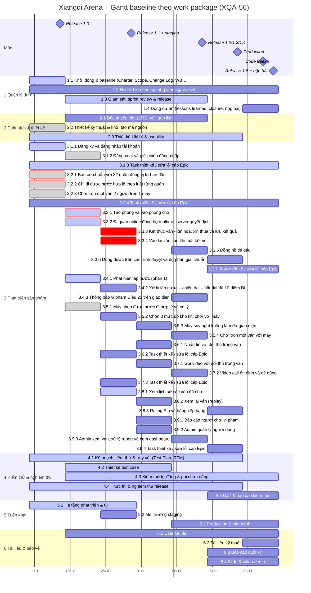

# Lịch 7 sprint & Gantt – Xiangqi Arena (XQA-56)

> Baseline lịch, phần 2/4. Nguồn: plan Jira XQA (11/10/2026) + trạng thái Jira/GitHub ngày 26/10/2026. Gantt sinh tự động từ WBS (`XQA-56-wbs.md`): mỗi thanh là 1 work package, độ dài = các sprint chứa Task/Sub-task của nó theo label `sprint-N`.

## 1. Lịch sprint và release

| Sprint | Ngày | Mục tiêu | Release | Số việc (baseline) | Trạng thái 26/10 |
|---|---|---|---|---:|---|
| S1 | 10/10–16/10 | Release 1.0 Core: bàn cờ + luật đi quân + chiếu/chiếu bí, chơi 2 người 1 máy, đăng ký/đăng nhập, CI; baseline phạm vi & lịch | 1.0 (16/10) | 28 | Đóng 23/10 (trễ 7 ngày so với 16/10). 22/28 việc xong |
| S2 | 17/10–23/10 | Chơi online end-to-end (server quyết định nước đi): phòng, sảnh, đi quân realtime; bắt đầu Điều 23 và AI | – | 24 | Không còn container riêng: việc chưa xong dồn sang S3. 12/24 việc xong |
| S3 | 24/10–30/10 | Release 1.1: kết thúc ván/hòa/thua, reconnect, Điều 23 đủ 10 điểm, lịch sử, AI 3 mức, staging | 1.1 (30/10) | 24 | Đang chạy (ngày 3/7) |
| S4 | 31/10–06/11 | Chat, Report, Admin users, Video call (signaling + client), replay, AI chạy Web Worker | – | 24 | Chưa bắt đầu |
| S5 | 07/11–13/11 | Release 1.2/1.3/1.4: Admin đầy đủ, video ổn định, chơi trọn ván với máy, đồng hồ (should) | 1.2 / 1.3 / 1.4 (13/11) | 24 | Chưa bắt đầu |
| S6 | 14/11–20/11 | Should-have (Elo, leaderboard), responsive, deploy production, regression RC, chuẩn bị UAT | – | 24 | Chưa bắt đầu |
| S7 | 21/11–27/11 | Release 1.5: UAT, code freeze 25/11, fix bug, báo cáo, slide, demo, đóng dự án | 1.5 (27/11) | 24 | Chưa bắt đầu |

Nhịp trong sprint: việc 1 hạn ngày thứ 3, việc 2 hạn ngày thứ 5, việc 3 hạn ngày cuối. Planning thứ 7, review thứ 6.

## 2. Milestone

| Mốc | Ngày | Điều kiện đạt | Trạng thái 26/10 |
|---|---|---|---|
| M1 – Release 1.0 Core | 16/10 | Bàn cờ + luật đi + chiếu/chiếu bí chơi 1 máy, đăng ký/đăng nhập, CI | Code xong 17/10 (PR #12, #13, #14). FE auth merge 24/10 (PR #23). CI xanh trên develop từ 21/10. Biên bản nghiệm thu XQA-64 "đạt có điều kiện" (21/10), hai điều kiện nay đã đạt → **chờ PM ký** |
| M2 – Release 1.1 + staging | 30/10 | Chơi online trọn ván (kết thúc, hòa/thua, reconnect), Điều 23 đủ 10 điểm, lịch sử, AI 3 mức, staging | Có rủi ro trượt: xem RSK-24, RSK-25 |
| M3 – Release 1.2/1.3/1.4 | 13/11 | Chat, Report, Admin, Video call, chơi trọn ván với máy | Chưa bắt đầu |
| M4 – Production | 20/11 | Deploy production, backup, Deployment doc | Chưa bắt đầu |
| M5 – Code freeze | 25/11 | Chỉ sửa bug UAT | – |
| M6 – Release 1.5 + nộp bài | 27/11 | UAT ≥5 người, báo cáo, slide, demo, closure | – |

## 3. Đường găng (critical path)

Theo plan 11/10: Board/FEN (XQA-42) → MoveGen (XQA-44, 45) → Chiếu/chiếu bí (XQA-49) → GameService (XQA-74) → Socket game events (XQA-75) → Đi quân online (XQA-76) → Kết thúc ván (XQA-90, 91, 92) → Reconnect (XQA-93, 94) → Nghiệm thu 1.1 (XQA-111, 30/10).

| Đoạn găng | Trạng thái thực tế 26/10 (repo) |
|---|---|
| XQA-42 → 44/45 → 49 | Merge 13–17/10 |
| XQA-74 GameService | Merge 24/10 (PR #24). Jira vẫn ghi In Progress |
| XQA-75 Socket game events | Merge 24/10 (PR #25) |
| XQA-76 Đi quân online | PR #26 đang mở, chờ test/merge |
| XQA-90/91/92 Kết thúc ván | Chưa bắt đầu, hạn 28/10 |
| XQA-93/94 Reconnect | Chưa bắt đầu, hạn 30/10 |

Trễ tích lũy trên đường găng: đoạn XQA-74 → 75 xong 24/10 thay vì 19–23/10 (trễ 1–5 ngày). Dự trữ còn lại tới 30/10 gần như bằng 0: XQA-90/91/92 phải xong 28/10 thì XQA-93/94 mới kịp 30/10.

## 4. Gantt

Màu theo trạng thái Jira 26/10: xám = xong, xanh nhạt = đang làm, tím = chưa bắt đầu. Đỏ (viền đỏ nếu đã xong) = Story trên đường găng. Vạch đỏ dọc = hôm nay. Ảnh: `XQA-56-gantt.svg`.

## 5. Tải theo người và sprint (giờ, 1 việc ≈ 4h)

| Người | Vai trò | S1 | S2 | S3 | S4 | S5 | S6 | S7 | Ngoài sprint | Tổng |
|---|---|---:|---:|---:|---:|---:|---:|---:|---:|---:|
| Thịnh | PM + BE (History, Admin/Report, AI) | 12 | 12 | 12 | 12 | 12 | 12 | 12 | 8 | 92 |
| Phát | BA + Game Core | 20 | 12 | 12 | 12 | 12 | 12 | 12 | 4 | 96 |
| Kiệt | BE Platform + DevOps | 16 | 12 | 12 | 12 | 12 | 12 | 12 | 0 | 88 |
| Khiêm | FE (bàn cờ, realtime client) | 12 | 12 | 12 | 12 | 12 | 12 | 12 | 0 | 84 |
| Nhân | UX + FE + WebRTC client | 16 | 12 | 12 | 12 | 12 | 12 | 12 | 0 | 88 |
| Quang | QA kỹ thuật (automation, CI) | 12 | 12 | 12 | 12 | 12 | 12 | 12 | 0 | 84 |
| Thiện | QA lead (Test Plan, RTM, nghiệm thu) | 12 | 12 | 12 | 12 | 12 | 12 | 12 | 0 | 84 |
| Thuận | Tài liệu, biên bản, test case | 12 | 12 | 12 | 12 | 12 | 12 | 12 | 0 | 84 |

Plan giữ đều 3 việc/người/sprint (12h). Tải chưa tính phần PM ngoài Jira (điều phối, review PR, họp) nên Thịnh thực tế nặng hơn bảng. Xem RSK-06, RSK-22.
